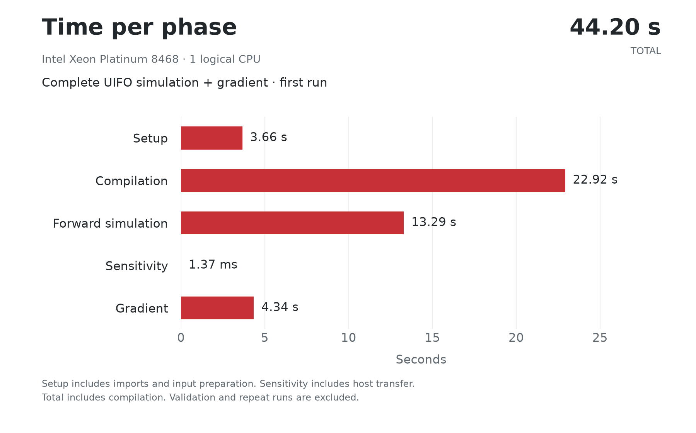

# Faster Physics — START Hack Munich 2026

Make **Differometor** faster while preserving its physical predictions and gradients.

This repository includes the public simulator source, example data, [challenge PDF](challenge.pdf), [editable brief](challenge.docx), and a complete start-here benchmark. No separate simulator checkout or GPU is required.

## Start here

Use **Python 3.12 on Linux or WSL2**, with **32 GB RAM recommended**. Unpack the supplied repository or clone it, then open a terminal in its root folder (the one containing this README). Git is optional for an extracted archive. Run:

```bash
python3.12 -m venv .venv
source .venv/bin/activate
python -m pip install --upgrade pip
python -m pip install -r requirements.txt
python -m pip install -e .
python start_here.py --cpus 1 --output benchmark-baseline.json
```

`--cpus 1` pins all execution to one logical CPU before importing JAX and limits numerical-library threads. It requires Linux or WSL. Omit it to use the CPUs available to your process on other systems. The full benchmark was tested in a 32 GB RAM allocation; its measured peak was about 14.4 GiB. Allow roughly 5 minutes for ten repetitions and the numerical checks; this varies by machine.

On success, the terminal prints `PASS` and the script writes **`benchmark-baseline.json`** and **`benchmark-baseline.png`**, a simple five-bar timing plot. Use `--repeats 3` for a quicker development run; the default is ten repetitions. Add `--save-arrays baseline.npz` to save results for numerical comparison.

## If setup fails

- **Python missing:** install Python 3.12 first. On Debian/Ubuntu, the matching `python3.12-venv` package may also be needed for virtual environments.
- **Windows:** use WSL2 and make enough RAM available to it. The single-CPU command uses Linux process affinity.
- **Process killed / out of memory:** close other memory-heavy applications or use a machine with more available RAM. Reducing `--repeats` shortens the run but does not reduce peak memory.
- **Numerical check fails:** restore the unchanged public fixtures and run the unmodified baseline with the pinned dependencies before investigating your changes.

## The workload

One full saved 3×3 UIFO (quasi-universal interferometer), all **101 frequencies from 800–3000 Hz**, and gradients for **193 physical design variables**. Every evaluation computes carrier fields, signal, quantum noise, detector sensitivity, powers and the gradient of mean log sensitivity relative to the public reference.

The complete first-run total includes input preparation, all compilation, the forward simulation, sensitivity and gradients. Imports, CPU initialization and result transfer are included. Validation and benchmark logging/report/plot generation are excluded. There is no optimization loop.

The five bars group the detailed measurements without dropping work. Setup includes imports, initialization and loading/building inputs. Compilation combines lowering and compilation for all stages. Sensitivity includes readout and host transfer. The raw JSON retains every stage and all warm repetitions.

## Improve and compare

1. Run the unmodified baseline in a fresh Python process.
2. Use the phase plot to find a bottleneck, then edit `differometor/`.
3. Run `python start_here.py --cpus 1 --output benchmark-candidate.json`.
4. Compare complete time, including compilation, on matching hardware, CPU affinity and software. Report median warm runtime separately and repeat measurements to assess variability.

Keep the setup, every frequency, double precision, physical outputs and gradients. The starter checks the public sensitivity reference and a numerical gradient at two perturbation sizes. These checks cover one setup; compare full saved arrays and additional public inputs when changing the numerical calculation. Precomputed answers and omitted calculations do not count.

Submit your code, before/after JSON reports and plots, reproduction commands, and a short explanation of the improvement and correctness checks.

## CPU baseline

Tested on **16 November 2026** on an **Intel Xeon Platinum 8468**, pinned to **one logical CPU** with **32 GB RAM** allocated. CPU affinity and numerical-library thread limits are recorded in the [raw report](benchmarks/cpu-baseline.json). No GPU was used.



| Measurement | Seconds |
| --- | ---: |
| Complete first-run total, including compilation | **44.204** |
| Total tracing/lowering and compilation | 22.918 |
| Median warm evaluation, ten repetitions | **17.679** |
| Warm minimum / maximum | 17.118 / 18.282 |

All 101 frequencies and 193 gradients were evaluated. The public sensitivity test and two-step numerical gradient check passed. This was measured on a shared worker, so record your own baseline. The current starter adds archive support and output-path checks to the measured version; the numerical workload is unchanged.

Replot any saved report without running the simulation:

```bash
python plot_timings.py benchmark-baseline.json --output benchmark-baseline.png
```

## Public source and license

The simulator is the unmodified public [Artificial Scientist Lab Differometor](https://github.com/artificial-scientist-lab/Differometor) at commit `b0dc7c79e7c72a1b010174f6bdcad01efa51d6ff`. This repository adds the Feyer hackathon brief and benchmarking tools. The full upstream instructions remain in [README.upstream.md](README.upstream.md); the upstream [MIT license](LICENSE) is retained.

[UPSTREAM.json](UPSTREAM.json) records the original simulator and fixture hashes.
